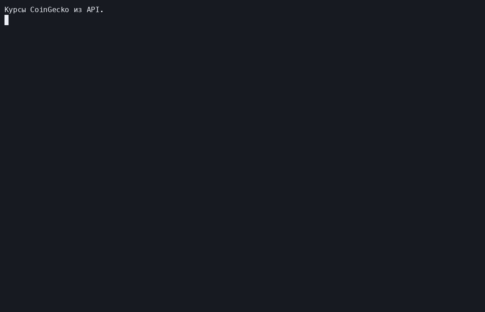

# ValutaTrade Hub

Консольный симулятор валютного портфеля: регистрация, покупка и продажа
виртуальной валюты, просмотр балансов и курсов.

## Запуск

Python 3.12+, uv. Автор: Naumov Pavel.

```bash
uv sync
uv run valutatrade
```

Для фиатных курсов задайте переменную `EXCHANGERATE_API_KEY`:

```bash
export EXCHANGERATE_API_KEY="ваш_ключ"
uv run valutatrade
```
Для CoinGecko предусмотрена `COINGECKO_DEMO_API_KEY`.
Ключи не нужно добавлять в код или репозиторий.

## Команды

```text
update-rates
register --username student --password example1234
login --username student --password example1234
buy --currency BTC --amount 0.05
sell --currency BTC --amount 0.01
show-portfolio
get-rate --from USD --to BTC
show-rates --top 2
update-rates --source coingecko
help
exit
```

`amount` — количество валюты. Покупка увеличивает её баланс, продажа
уменьшает. Стоимость в USD показывается справочно; USD-кошелёк автоматически
не меняется. 

## Структура

В `valutatrade_hub/`:

- `core/` — модели, валюты, исключения и операции;
- `infra/` — настройки и JSON-хранилище;
- `parser_service/` — клиенты API и обновление курсов;
- `cli/` — ввод команд и вывод результатов.

Данные сохраняются в `data/`, журналы — в `logs/`.
`rates.json` хранит текущие курсы, `exchange_rates.json` — историю.
TTL кэша — 300 секунд после получения ответа. Просроченный кэш нужно обновить
командой `update-rates`. Настройки находятся в `[tool.valutatrade]` файла
`pyproject.toml`, параметры API — в `parser_service/config.py`.

## Проверка

```bash
uv run ruff check .
uv run python -m unittest discover -s tests
uv build
```



[Запись asciinema](docs/demo.cast)

Запустить сценарий: `uv run python scripts/demo.py`.
Посмотреть запись: `uvx asciinema play docs/demo.cast`.
Без флагов демо использует тестовые курсы и временные данные.
С реальными курсами: `uv run python scripts/demo.py --live`.
Запись выше сделана с курсами CoinGecko; фиатный API требует отдельный ключ.
